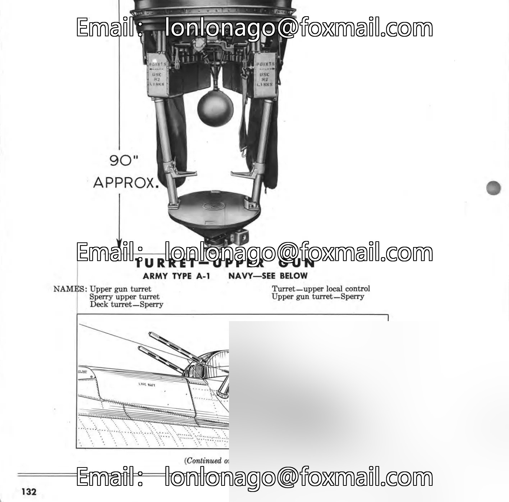
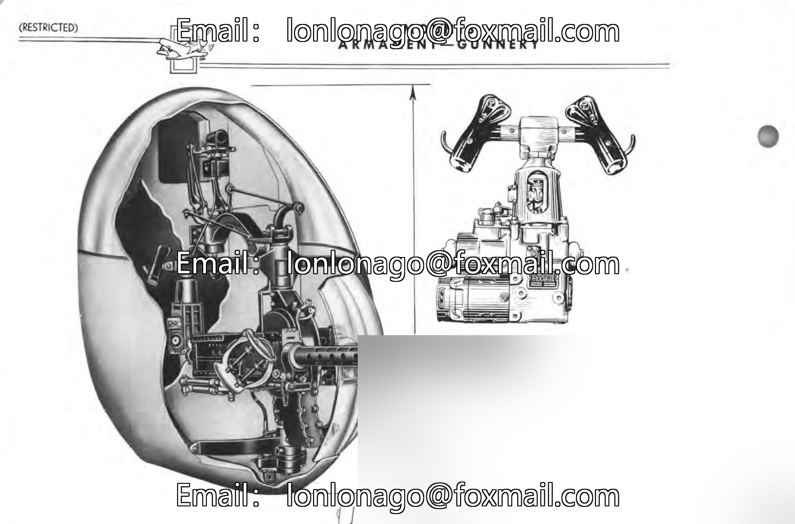
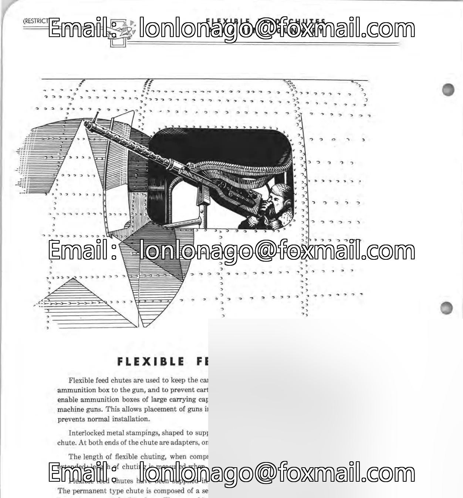
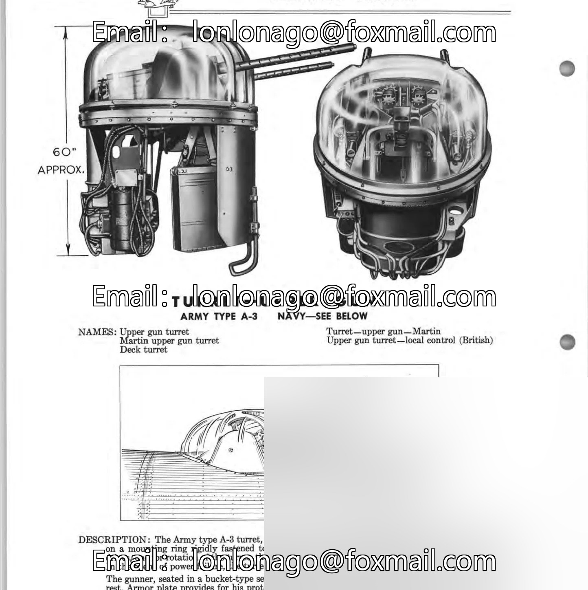

# "1944 published *Air Force Equipment Index (Volume 5: Arms)", belongs to.

## Body

1944 Published *Army Aircraft Equipment Index (Volume 5: Armament)*, which is a restricted military document marked with "(RESTRICTED)".
1. Core content analysis
1. Aircraft armament technology manual
Records military aircraft weapon systems of the US, including machine guns, aerial guns, bombs, rocket launchers, etc.
2. Ammunition specifications and model
Details the specific parameters of .50-caliber cartridges, 20mm machine gun shell etc.
3. Comparison of American and British naval equipment
Provides performance comparison of equipment such as the US M2 machine gun and British Hispano machine gun.
4. Maintenance guides and tactical deployment
Contains technical guidance on installation, maintenance, tactical deployment of weapon systems.
2. Historical background

In 1944, during the latter half of World War II, the U.S. military urgently needed to integrate aviation equipment data to support operational actions on the European and Pacific fronts.
Such documents typically involve confidential technical parameters or tactical manuals, belonging to important military technical materials.
have replicability, and once sold, they are not returned.

This is a 1944 publication of the 《Army Air Equipment Index (Volume 5: Armament)》, labeled as a restricted military document, covering aviation armament technology manuals, ammunition specifications, British-American naval equipment comparisons and maintenance guides.

<!-- AI_ENRICHED -->

## Images

## Payment

Here is a pay link on Stripe ( https://buy.stripe.com/3cs8yP7sY87d0vu9AB ). Please contact me lonlonago@foxmail.com after funding $89, and I will send you a complete data files , thank you!

